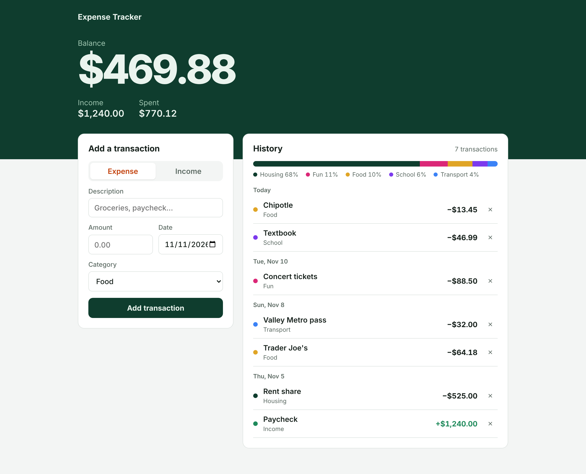

<h1 align="center">Expense Tracker</h1>

<p align="center">
  Log income and spending, see your balance at a glance, and find out where your money actually goes.
</p>

<p align="center">
  <a href="https://bezalelchris.github.io/Expense-tracker/"><strong>Live demo</strong></a>
</p>

<p align="center">
  
  
  
  
</p>



## Features

- **Balance, income and spending** update instantly as you add or delete transactions.
- **Spending by category:** a breakdown bar shows the share going to food, housing, transport, fun, school and other.
- **History grouped by day,** newest first, with dates you can backfill.
- **Clear input validation** with inline messages instead of pop-up alerts.
- **Saves in your browser** with `localStorage`. Nothing is sent anywhere.
- Dark mode, mobile layout and keyboard-accessible controls.

## Engineering notes

| Problem | Fix |
|---|---|
| The first version rendered descriptions with `innerHTML`, so typing `` would run code. | All user text goes through `textContent`. |
| Users had to remember that expenses are negative numbers. | An Expense / Income toggle; amounts are always entered as positive. |
| Saved data from the old format (signed amounts, no dates) would break the new UI. | `load()` migrates old entries on the fly, so nobody loses history. |
| `localStorage` throws in some private-browsing modes. | Reads and writes are wrapped in `try/catch`; the app still works for the session. |

## Run locally

No build step:

```bash
git clone https://github.com/bezalelchris/Expense-tracker.git
cd Expense-tracker
open index.html        # or just double-click it
```

## Roadmap

- Monthly view and month-over-month comparison
- CSV export
- Budgets per category with a warning when you're close
